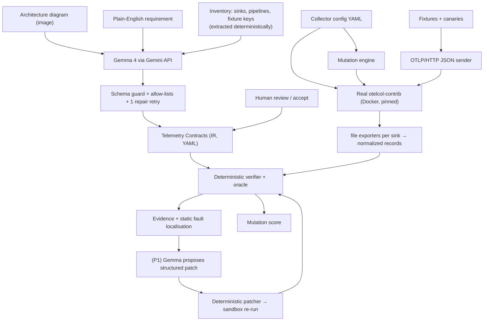

# PIPEWITNESS — Build Specification

> **For coding agents (Antigravity / Claude Code):** this file is the source of truth.
> Read it fully before writing code. When something here conflicts with what you
> observe in the real tool (e.g. Collector config syntax for the pinned version),
> trust the real tool, adapt minimally, keep the semantics, and note the change in
> `docs/DECISIONS.md`. Never "fix" a problem by mocking the Collector or faking a model call.

---

## 0. Event rules that constrain this build (NIAT-KKH × MLH Hack Day)

- **Build window is 120 minutes.** Both challenge briefs use a two-hour plan; follow the organizers' announced window and deadline. The 120-minute cut in §19 is THE plan; anything beyond it is post-event.
- **Do not build the submission before the event.** Before the event: install tools, pull the Collector image, test a Gemma API call, read docs. Create the project repo, write code, and commit **only during the build window**, so the commit history shows event-time work.
- **Project code lives in our own public repo** with an open-source license. Submission = a Markdown file from the event's `SUBMISSION_TEMPLATE.md`, PR'd to `niat-KKH/Hacktoberfest-2026-NIAT-KKH`; it does not replace the MLH platform submission.
- **Gemma track:** Gemma 4 via the Gemini API; the Gemma-powered result must be obvious within the first 30 seconds of the demo; have a fallback sample if the API fails. Confirm model access with organizers.
- **Open-source AI track:** AI must be central (not decorative); a harness needs original implementation. Using an AI coding assistant alone does not count, so show the AI component in the architecture and the live demo.
- **Disclose AI-assisted development** (Antigravity, Claude Code) in the submission's "Approach and technologies" section.
- Entering both categories: confirm eligibility with organizers and provide evidence for each.

---

## 1. Product definition

**Name:** PIPEWITNESS
**Category:** Telemetry contract testing (pre-deployment verification for observability pipelines)
**One-line pitch:** Executable contracts for telemetry pipelines — proven against a real OpenTelemetry Collector, with mutation testing to prove the tests work.

**Primary user:** a platform / SRE engineer who edits OpenTelemetry Collector YAML and needs to know, before shipping, that:
- secrets and PII never reach an external exporter,
- fields other teams rely on (e.g. `request.id`, `trace_id`) survive every transform,
- the right records reach the right destination (e.g. ERROR → SIEM) and the wrong ones don't.

**Current workaround:** run the Collector locally, eyeball debug output, or hand-write one-off assertions. "Config is valid and starts" is treated as "config is correct". Nobody measures whether those checks would even catch a regression.

**What PIPEWITNESS adds (the three original primitives — build these well):**
1. **Telemetry Contract IR** — a small, versionable YAML/JSON format of machine-checkable invariants over pipeline output (forbidden values, field preservation, routing). Verified deterministically against captured output of a *real* Collector run.
2. **Telemetry Mutation Engine + Mutation Score** — structure-aware mutations of the Collector config (drop a processor, delete an OTTL statement, perturb a redacted key, weaken a filter, swap processor order). Re-run contracts on every mutant. A surviving mutant means the contract suite is too weak. Score = killed / (killed + survived).
3. **Evidence records with static fault localisation** — every FAIL names the case, the canary, the sink, the pipeline path, and which processors on that path do / don't reference the offending key.

**Where AI fits (proposes, never judges):**
- **Gemma 4 (via Gemini API, multimodal):** reads an architecture diagram image + a plain-English requirement and *proposes* contracts, each with a quoted source. Human reviews/accepts.
- **Gemma 4 (P1):** given a failing evidence record, proposes a *structured patch* (not free YAML). PIPEWITNESS applies it in a sandbox, re-runs all contracts + mutations, and only labels it **VERIFIED FIX** if everything passes.
- Gemma 4 is open-weight (Apache 2.0), so the same model family can run locally via Ollama for sensitive configs (optional P2 adapter).

---

## 2. Non-negotiable rules

1. **AI never decides PASS/FAIL.** Only `pipewitness/verify.py` produces verdicts, from captured Collector output.
2. **No model-generated code is executed.** Model output is data: validated JSON → Pydantic → allow-listed operations.
3. **Real Collector, real run.** No simulator in the verdict path. If the Collector can't run, the verdict is `INCONCLUSIVE`, never PASS.
4. **Synthetic data only.** All secrets/PII are fake canaries (see §7). No real keys, logs, or customer data in the repo.
5. **Honest labels in UI and docs.** "LIVE Gemma" vs "RECORDED Gemma response (sha, timestamp)". No accuracy/compliance claims beyond the measured benchmark.
6. **Never commit `.env`.** Only `.env.example`.
7. Three verdicts only: `PASS`, `FAIL`, `INCONCLUSIVE` (runtime error, timeout, unsupported component, or vacuous check).

---

## 3. Architecture



---

## 4. Tech stack (decided)

| Component | Decision | Reason |
|---|---|---|
| Python 3.11+ | KEEP | Team skill, fast to build |
| Pydantic v2 | KEEP | Contract IR + model-output guard |
| ruamel.yaml | REPLACE PyYAML | Round-trip edits for mutations/patches, readable diffs |
| httpx | ADD | Send OTLP/HTTP **JSON** directly — exact control of attributes, resource attrs, canaries |
| OTel Python SDK / protobuf | REMOVE | Not needed; JSON payloads are simpler and fully controlled |
| otelcol-contrib (Docker image `otel/opentelemetry-collector-contrib`, pinned tag + digest) | KEEP | Real processor semantics |
| Local `otelcol-contrib` binary | KEEP as fallback | If Docker fails |
| Testcontainers | REMOVE | Extra dependency; plain `docker` CLI via subprocess is enough |
| Typer + rich | ADD | CLI with exit codes for CI |
| Streamlit | KEEP (over React) | Fastest serious-looking UI; `st.graphviz_chart` accepts DOT strings |
| FastAPI | REMOVE | Not needed for MVP |
| google-genai | KEEP | Official SDK for Gemini API → Gemma 4 |
| Ollama (`ollama` python pkg) | OPTIONAL (P2) | Local open-weight Gemma 4 |
| pytest | KEEP | Harness tests + benchmark gates |
| Report | JSON (canonical) + Markdown; HTML P2 | |
| GitHub Actions | P1 | CI gate demo |

Models:
- Primary: `gemma-4-26b-a4b-it` (env `PW_GEMMA_MODEL`), alternate `gemma-4-31b-it`.
- Local optional: Ollama `gemma4:e4b` (laptop) / `gemma4:12b` (≥12 GB GPU). **Set `num_ctx` explicitly** (Ollama's default context is small).

---

## 5. Repository structure

```text
pipewitness/
├── README.md
├── LICENSE                      # Apache-2.0
├── pyproject.toml
├── .env.example                 # GEMINI_API_KEY=, PW_GEMMA_MODEL=gemma-4-26b-a4b-it, PW_COLLECTOR_IMAGE=
├── .gitignore                   # .env, runs/, __pycache__, .venv
├── runtime.lock                 # pinned collector image tag + digest, tested OS
├── app.py                       # Streamlit UI
├── pipewitness/
│   ├── __init__.py
│   ├── cli.py                   # verify | mutate | compile | fix | demo
│   ├── contracts.py             # Contract IR (Pydantic) + YAML load/dump
│   ├── fixtures.py              # fixture YAML → OTLP JSON payloads, canary registry
│   ├── inventory.py             # deterministic: sinks, pipelines, processors, keys referenced, fixture keys
│   ├── runner.py                # collector lifecycle (docker|binary), validate, send, stop, collect
│   ├── capture.py               # parse file-exporter JSON lines → NormalizedRecord
│   ├── oracle.py                # canary detection (exact/substring; P2: base64/url-encoded, regex shapes)
│   ├── verify.py                # deterministic evaluator → verdicts + evidence
│   ├── localize.py              # static fault localisation from config + evidence
│   ├── mutate.py                # mutation operators, mutant runner, score
│   ├── evidence.py              # evidence models, JSON/Markdown render
│   └── ai/
│       ├── gemma.py             # Gemini API adapter (+ optional ollama backend), record/replay
│       ├── prompts.py           # versioned prompt templates (PROMPT_VERSION constant)
│       ├── guard.py             # schema validation, allow-lists, repair loop
│       └── remediate.py         # (P1) patch-op proposal + verified fix loop
├── examples/checkout/
│   ├── collector.vulnerable.yaml
│   ├── collector.fixed.yaml
│   ├── telemetry.yaml
│   ├── contracts.yaml           # human-authored, independent of the model
│   ├── contracts.weak.yaml      # deliberately weak suite (for mutation-score contrast)
│   ├── requirements.txt         # plain-English requirement used in demo
│   ├── architecture.png         # annotated diagram (generated or photographed whiteboard)
│   └── recorded/                # recorded Gemma responses (input sha, model, prompt version, timestamp)
├── benchmark/
│   └── run_benchmark.py
├── skills/verify-telemetry-intent/SKILL.md   # P2
├── .github/workflows/pipewitness.yml         # P1
├── tests/
└── docs/
    ├── DECISIONS.md
    ├── comparison.md
    └── model-and-data.md
```

---

## 6. Telemetry Contract IR

### 6.1 YAML format (v0)

```yaml
version: pipewitness/v0
sinks:                       # logical sink id -> exporter id in the collector config
  siem:      { exporter: file/siem,      external: true }
  analytics: { exporter: file/analytics, external: true }

contracts:
  - id: no-secret-canaries
    type: forbidden_value
    sinks: [siem, analytics]
    canaries: [password, token]
    severity: critical
    source: { kind: text, quote: "Passwords and tokens must never leave the collector" }

  - id: no-email-export
    type: forbidden_value
    sinks: [siem, analytics]
    canaries: [email]
    severity: high

  - id: errors-reach-siem
    type: must_reach
    sink: siem
    when: { severity_at_least: ERROR }
    severity: high

  - id: debug-not-in-siem
    type: must_not_reach
    sink: siem
    when: { severity_below: WARN }
    severity: medium

  - id: request-id-survives
    type: preserve_field
    sink: analytics
    field: { scope: log, key: request.id }
    severity: high

  - id: all-reach-analytics
    type: must_reach
    sink: analytics
    when: { all: true }
    severity: medium

  - id: trace-correlation-siem
    type: preserve_field
    sink: siem
    field: { scope: record, key: trace_id }
    when: { severity_at_least: ERROR }
    severity: medium
```

### 6.2 Semantics (deterministic, implement exactly)

| Type | PASS when | FAIL when | INCONCLUSIVE when |
|---|---|---|---|
| `forbidden_value` | no canary value appears in any string field (body, log attrs, resource attrs, scope attrs) of any record in the listed sinks **and** ≥1 case that carried that canary reached that sink | any canary appears | no canary-carrying case reached the sink (vacuous) |
| `must_reach` | every selected case appears ≥1× in sink | any selected case missing | run failed / no cases selected |
| `must_not_reach` | no selected case appears in sink | any selected case appears | run failed / no cases selected |
| `preserve_field` | for every selected case that reached the sink and had the field on input, output has same field, same value | field missing or value changed | no applicable case reached the sink |

- `when` selectors: `all`, `cases: [ids]`, `severity_at_least`, `severity_below`, `has_attribute: {scope,key}`. Severity order: DEBUG=5, INFO=9, WARN=13, ERROR=17, FATAL=21.
- `field.scope`: `log` (log record attributes), `resource` (resource attributes), `record` (`body`, `trace_id`, `span_id`, `severity_number`).
- **Non-vacuity is enforced by the verifier, not by the model.** A pipeline that drops everything can never PASS a privacy contract.
- Contract ids unique; sinks must exist in `sinks`; canary names must exist in the fixture canary registry.

---

## 7. Fixtures and canaries

`examples/checkout/telemetry.yaml`:

```yaml
canaries:
  password: PW_CANARY_7f3a91
  token:    TOKEN_CANARY_b81c42
  email:    canary.user@pipewitness.invalid

cases:
  - id: c1
    severity: ERROR
    body: "[pw:c1] login failed"
    trace_id: 5b8efff798038103d269b633813fc60c
    span_id: eee19b7ec3c1b174
    resource: { service.name: auth }
    attributes:
      pipewitness.case: c1
      user.password: "${canary.password}"
      auth.token: "${canary.token}"
      user.email: "${canary.email}"
      request.id: req-c1
  - id: c2
    severity: INFO
    body: "[pw:c2] checkout ok"
    resource: { service.name: checkout }
    attributes:
      pipewitness.case: c2
      request.id: req-c2
      user.id: u-123
  - id: c3
    severity: DEBUG
    body: "[pw:c3] cache miss"
    resource: { service.name: checkout }
    attributes:
      pipewitness.case: c3
  - id: c4
    severity: ERROR
    body: "[pw:c4] payment declined"
    trace_id: 0af7651916cd43dd8448eb211c80319c
    span_id: b7ad6b7169203331
    resource: { service.name: payments, user.email: "${canary.email}" }   # resource-scope leak case
    attributes:
      pipewitness.case: c4
      request.id: req-c4
```

- **Case identity:** attribute `pipewitness.case`; fallback: `[pw:<id>]` marker in body (in case a transform deletes the attribute).
- Payload: OTLP/HTTP JSON to `POST http://127.0.0.1:<port>/v1/logs`, `Content-Type: application/json`. Group cases by identical `resource` into separate `resourceLogs`. `traceId`/`spanId` as hex strings, `timeUnixNano` as string, `severityNumber` int, `severityText`, `body: {stringValue}`, attributes as `[{key, value:{stringValue}}]`.

---

## 8. Runner (real Collector)

**Docker mode (default):**
1. Write the config to `runs/<run_id>/config.yaml`, create `runs/<run_id>/captures/` and make it writable by the container user (`chmod 777`; the contrib image runs as non-root).
2. Validate first: `docker run --rm -v <cfg>:/cfg.yaml:ro <image> validate --config=/cfg.yaml`. Non-zero exit → result `INVALID_CONFIG` (for mutants: mutant is *invalid*, not killed).
3. Start: `docker run -d --name pw-<run_id> -p <free_port>:4318 -v <cfg>:/etc/otelcol-contrib/config.yaml:ro -v <captures>:/captures <image>`.
4. Readiness: retry POST of the payload until HTTP 200 (timeout 15 s).
5. Wait ≥ 1 s (batch timeout is 200 ms in examples), then `docker stop -t 10` (graceful shutdown flushes the file exporters), collect logs (`docker logs`) into the run dir, `docker rm`.
6. Parse `captures/*.jsonl`. Timeout or crash → `INCONCLUSIVE` with collector logs attached.
- Free port per run so mutants can run in parallel (max 4 concurrent).
- Record image tag **and digest** (`docker image inspect`) in every evidence record.

**Binary fallback (`PW_RUNNER=binary`):** same flow with `subprocess` and a local `otelcol-contrib`; the runner rewrites `/captures/` paths in file exporters to the local run dir (record this substitution in evidence).

**Exporter substitution (P1, for user configs):** any non-file exporter referenced by a pipeline is replaced by a file exporter for capture; pipeline references updated; substitution listed in evidence ("tests processing behaviour, not real network delivery").

---

## 9. Capture normalisation

File exporter writes JSON lines, each an OTLP logs export object. Normalise to:

```python
class NormalizedRecord(BaseModel):
    sink: str                 # logical sink id
    exporter: str
    case_id: str | None
    severity_number: int | None
    body: str | None
    trace_id: str | None
    span_id: str | None
    log_attrs: dict[str, str | int | float | bool | None]
    resource_attrs: dict[str, ...]
    scope_attrs: dict[str, ...]
```
Convert non-string OTLP value types to Python values; flatten nested kvlist/array values into strings for canary scanning.

---

## 10. Verifier + oracle

- `verify(contracts, fixtures, captures, run_meta) -> Report` — pure function, no I/O. Unit-test it with hand-built captures.
- Oracle P0: exact + substring match of canary values in every string field. P2 layers: base64 / URL-encoded canary variants; regex shapes (JWT-like, AWS-key-like, card-like using Luhn) — only on synthetic data.
- Report: per-contract verdict, per-case findings, totals, overall exit status.

CLI exit codes: `0` all PASS · `1` any FAIL · `2` any INCONCLUSIVE/runtime error (and no FAIL).

---

## 11. Mutation engine

Operators (enumerate automatically from the parsed config; skip `batch` and `memory_limiter` as non-semantic):

| Operator | Mutation |
|---|---|
| `drop_processor` | remove processor P from pipeline L |
| `swap_adjacent` | swap two adjacent non-batch processors in a pipeline |
| `drop_ottl_statement` | delete one statement from a transform processor |
| `drop_ottl_block` | delete a context block with >1 statement |
| `perturb_key` | change a key literal in `delete_key(...)` / attributes-processor `key:` (append `_x`) |
| `weaken_filter` | shift a `SEVERITY_NUMBER_*` constant in a filter condition one level up |
| `drop_exporter` | remove an exporter from a pipeline only if the pipeline has >1 exporters |

Each mutant record: `id, operator, location (yaml path), unified diff, validity (validate result), outcome: killed_by[] | survived | invalid | inconclusive`.
**Score = killed / (killed + survived)**; invalid and inconclusive reported separately, never counted as kills.
Survivors are labelled "not detected — add a contract, or review: may be an equivalent mutant".

---

## 12. Evidence

JSON (canonical):
```json
{
  "contract_id": "no-secret-canaries",
  "verdict": "FAIL",
  "severity": "critical",
  "sink": "siem", "exporter": "file/siem", "pipeline": "logs/siem",
  "case_id": "c1",
  "canary": "password",
  "input":    {"scope": "log", "key": "user.password", "value": "PW_CANARY_7f3a91"},
  "observed": {"scope": "log", "key": "user.password", "value": "PW_CANARY_7f3a91"},
  "pipeline_path": ["receiver:otlp", "processor:filter/errors_only", "processor:batch", "exporter:file/siem"],
  "localisation": {
    "on_path_referencing_key": [],
    "elsewhere_referencing_key": ["transform/scrub (logs/analytics)"],
    "explanation": "No processor on logs/siem references user.password; transform/scrub does, but only on logs/analytics."
  },
  "run": {"config_sha256": "…", "fixture_sha256": "…", "collector_image": "otel/opentelemetry-collector-contrib:<tag>@sha256:…", "mode": "docker"}
}
```
`localize.py` is deterministic: it scans processors on the pipeline path for references to the key (string literal search in OTTL statements, attributes actions, redaction allow/block lists) and lists other pipelines' processors that reference it.

---

## 13. Gemma 4 integration

### 13.1 Contract compiler (P0)
- Inputs: diagram image bytes, requirement text, and the **inventory** JSON (sink ids, pipeline ids, fixture attribute keys per scope, canary names, allowed contract types). Never send the faulty config logic as "intent".
- Call:
```python
from google import genai
from google.genai import types
client = genai.Client()  # reads GEMINI_API_KEY
resp = client.models.generate_content(
    model=os.getenv("PW_GEMMA_MODEL", "gemma-4-26b-a4b-it"),
    contents=[types.Part.from_bytes(data=img_bytes, mime_type="image/png"), prompt_text],
    config=types.GenerateContentConfig(temperature=0, response_mime_type="application/json"),
)
```
  If a config option is rejected by the API for Gemma, drop it and rely on prompt + guard. Verify in preflight.
- Output schema: `{"contracts": [Contract...], "unresolved": [{"quote": str, "reason": str}]}`; every contract must carry `source: {kind: diagram|text, quote}` and `status: ready|review_required`.
- **Guard:** strip code fences → `json.loads` → Pydantic → allow-lists (sink ids, keys, canaries, types) → max 12 contracts. On failure: one repair call with the validation errors appended. Still failing → show `unresolved`, never invent.
- **Record/replay:** every successful live response saved to `examples/<x>/recorded/<input_sha>.json` with model id, prompt version, timestamp. Replay only for the identical input sha, labelled "RECORDED".
- UI shows a diff between model contracts and the human `contracts.yaml` (agreement badge).

### 13.2 Verified remediation (P1)
- Gemma receives: failing evidence records, the config, and the **allowed patch-op schema**:
  - `add_processor_to_pipeline {pipeline, processor, position}`
  - `define_transform_processor {id, context, statements[]}` (statements limited to `delete_key`, `delete_matching_keys`, `set(..., SHA256(...))` / `replace_pattern` patterns)
  - `add_ottl_statement {processor, context, statement}`
  - `remove_ottl_statement {processor, index}`
  - `replace_ottl_statement {processor, index, statement}`
- Deterministic patcher applies ops with ruamel in a copy → `validate` → full contract run → mutation run.
- Label **VERIFIED FIX** only if: all contracts PASS, no previously passing contract regressed, mutation score ≥ previous. Otherwise **REJECTED PATCH** with the failing evidence. Max 2 attempts.

### 13.3 Optional local backend (P2)
Same adapter interface with `PW_BACKEND=ollama`, model `gemma4:e4b`, `options={"num_ctx": 16384}`, `format="json"`, images via `images=[path]`. Test before the event; never download during the demo.

---

## 14. UI (Streamlit, single page)

```
┌ PIPEWITNESS ─────────────────────────────── mode: LIVE Gemma | Collector <tag> ┐
│ [1 Intent]  diagram image + requirement text → "Compile with Gemma 4"          │
│             contracts table w/ source quotes, agreement badge, Accept button   │
│ [2 Pipeline] graphviz DOT of pipelines; failing path edges red                  │
│ [3 Verify]  config selector (vulnerable/fixed/patched) → Run → verdict chips    │
│ [4 Evidence] selected FAIL: input vs observed, path, localisation sentence     │
│ [5 Mutations] Run → table (operator, diff, outcome) + score; weak vs strong     │
│ [6 Fix] (P1) Propose fix → patch ops → re-run → VERIFIED FIX / REJECTED         │
└────────────────────────────────────────────────────────────────────────────────┘
```
Keep it one page, big verdict colours, monospace evidence. Cache run results in `st.session_state`.

---

## 15. CLI

```bash
pipewitness verify  --config C --contracts K --telemetry T [--json out.json]
pipewitness mutate  --config C --contracts K --telemetry T [--min-score 0.8]
pipewitness compile --image D.png --requirements R.txt --config C --telemetry T -o contracts.yaml
pipewitness fix     --config C --contracts K --telemetry T -o patched.yaml      # P1
pipewitness demo    # runs the checkout example end-to-end
```

---

## 16. Demo data

### 16.1 `collector.vulnerable.yaml`
Seeded bugs: (a) redaction only on the analytics branch → secrets leak to SIEM; (b) over-broad regex `.*(token|id)$` meant for tokens/user ids also deletes `request.id`; (c) email never removed, including the resource-scope copy.

```yaml
receivers:
  otlp:
    protocols:
      http:
        endpoint: 0.0.0.0:4318

processors:
  batch:
    timeout: 200ms
  filter/errors_only:
    error_mode: ignore
    logs:
      log_record:
        - 'severity_number < SEVERITY_NUMBER_ERROR'
  transform/scrub:
    error_mode: ignore
    log_statements:
      - context: log
        statements:
          - delete_key(attributes, "user.password")
          - delete_matching_keys(attributes, ".*(token|id)$")

exporters:
  file/siem:
    path: /captures/siem.jsonl
  file/analytics:
    path: /captures/analytics.jsonl

service:
  pipelines:
    logs/siem:
      receivers: [otlp]
      processors: [filter/errors_only, batch]
      exporters: [file/siem]
    logs/analytics:
      receivers: [otlp]
      processors: [transform/scrub, batch]
      exporters: [file/analytics]
```

### 16.2 `collector.fixed.yaml`
```yaml
receivers:
  otlp:
    protocols:
      http:
        endpoint: 0.0.0.0:4318

processors:
  batch:
    timeout: 200ms
  filter/errors_only:
    error_mode: ignore
    logs:
      log_record:
        - 'severity_number < SEVERITY_NUMBER_ERROR'
  transform/redact:
    error_mode: ignore
    log_statements:
      - context: log
        statements:
          - delete_key(attributes, "user.password")
          - delete_key(attributes, "auth.token")
          - delete_key(attributes, "user.email")
      - context: resource
        statements:
          - delete_key(attributes, "user.email")

exporters:
  file/siem:
    path: /captures/siem.jsonl
  file/analytics:
    path: /captures/analytics.jsonl

service:
  pipelines:
    logs/siem:
      receivers: [otlp]
      processors: [transform/redact, filter/errors_only, batch]
      exporters: [file/siem]
    logs/analytics:
      receivers: [otlp]
      processors: [transform/redact, batch]
      exporters: [file/analytics]
```
> Syntax for `filter` / `transform` changes across Collector versions. Run `validate` against the pinned image in preflight; if it rejects these forms, adapt to that version's README syntax while keeping identical semantics, and record the change in `docs/DECISIONS.md`.

### 16.3 Expected verification results

| Contract | vulnerable | fixed |
|---|---|---|
| no-secret-canaries | **FAIL** — siem/c1 has `user.password` and `auth.token` canaries | PASS |
| no-email-export | **FAIL** — siem & analytics: c1 log attr, c4 resource attr | PASS |
| errors-reach-siem | PASS | PASS |
| debug-not-in-siem | PASS | PASS |
| request-id-survives | **FAIL** — analytics c1, c2, c4 missing `request.id` (regex) | PASS |
| all-reach-analytics | PASS | PASS |
| trace-correlation-siem | PASS | PASS |

### 16.4 Expected mutation results (on `collector.fixed.yaml`)

| Mutant | Strong suite (`contracts.yaml`) | Weak suite (`contracts.weak.yaml` = only `errors-reach-siem`, `all-reach-analytics`) |
|---|---|---|
| drop_processor siem/transform/redact | killed (secrets, email) | survived |
| drop_processor siem/filter/errors_only | killed (debug-not-in-siem) | survived |
| drop_processor analytics/transform/redact | killed | survived |
| swap_adjacent siem transform/redact ↔ filter | **survived** (likely equivalent) | survived |
| drop_ottl_statement ×4 | killed | survived |
| drop_ottl_block (log) | killed | survived |
| perturb_key ×4 | killed | survived |
| weaken_filter ERROR→FATAL | killed (errors-reach-siem) | killed |
| **Score** | **13/14 ≈ 93%** | **1/14 ≈ 7%** |

(Exact counts depend on the operator enumeration; the test asserts the *shape*: strong ≫ weak, the swap survivor is reported honestly.)

### 16.5 Demo requirement text (`requirements.txt`)
> Passwords, auth tokens and customer emails must never leave the collector — for any destination. Every ERROR log must reach the SIEM, and debug noise must not. Analytics needs request.id intact on every log.

### 16.6 Diagram
Generate `architecture.png` with Pillow (boxes: Auth/Checkout/Payments services → OTel Collector → SIEM (external) / Analytics (external)) with hand-style red annotations: "NO passwords / tokens / emails past here", "ERROR → SIEM only", "keep request.id". A photographed whiteboard drawing is even better for the live demo — support any PNG/JPEG.

---

## 17. Benchmark (small, credible)

- **Configs:** 10 known-good (fixed config + semantics-preserving variants: batch params, extra no-op attributes, reordered equivalent statements) and 10 known-bad (each a single seeded fault with a ground-truth expected FAIL contract).
- **Metrics:** contract detection rate on bad configs, false positives on good configs, mutation score (strong vs weak), median run time per config, Gemma contract validity rate (5 runs × 2 diagrams: schema-valid %, agreement with human contracts %), patch success rate (P1), model latency.
- Output `benchmark/results.md` with the raw table. Report failures too.

---

## 18. Priorities

**P0 — must work:** Docker runner + validate · fixtures → OTLP JSON · capture normalisation · Contract IR (5 types) · deterministic verifier with non-vacuity · evidence JSON + console · vulnerable/fixed example · mutation engine (≥4 operators) + score · Gemma compile from image+text with guard + record/replay · minimal Streamlit · README + Apache-2.0.

**P1 — differentiating:** verified remediation loop · strong-vs-weak mutation contrast in UI · static fault localisation · benchmark · CLI exit codes + GitHub Action · binary fallback · exporter substitution for real configs.

**P2 — demo polish:** oracle layers (encoded canaries, shape regexes) · Ollama local backend · Agent Skill package · HTML report · pipeline graph highlighting.

**P3 / do NOT build now:** traces & metrics signals · multi-agent orchestration · vector DB/RAG · Kubernetes · hosted multi-tenant service · auto-PRs · real vendor backends · load/backpressure/latency testing · React frontend · compliance claims (GDPR/PCI/HIPAA/SOC 2 — say "technical evidence for data-minimisation controls" only).

---

## 19. Build phases (checkpoints are mandatory)

| Phase | Goal | Checkpoint (must be demonstrated, not claimed) |
|---|---|---|
| 0 Preflight | pin image, validate both demo configs, one Gemma image call | `validate` exit 0 for both configs; Gemma returns text for an image |
| 1 Runner + capture | real round-trip | `vulnerable` run produces `siem.jsonl` + `analytics.jsonl` with normalised c1–c4 |
| 2 Contracts + verifier | verdicts | `pipewitness verify` matches table §16.3 for both configs; pytest for semantics incl. non-vacuity |
| 3 Mutations | score | strong ≫ weak per §16.4; invalid mutants excluded |
| 4 Gemma compile | AI → contracts | from `architecture.png` + `requirements.txt`, guarded contracts run through the verifier; recorded response saved |
| 5 UI | demo-able | full flow without terminal |
| 6 Remediation (P1) | verified fix | Gemma patch on vulnerable config → VERIFIED FIX or honest REJECTED |
| 7 Ship | submission | README, LICENSE, benchmark table, comparison doc, demo recording |

**THE event plan: 120 minutes**

| Minutes | Work | Done when |
|---|---|---|
| 0–10 | Create repo + Apache-2.0 LICENSE, pyproject, .gitignore; write demo configs/fixtures; `validate` both configs; one live Gemma image call | validate exit 0 ×2; Gemma answers |
| 10–30 | fixtures.py, runner.py, capture.py | vulnerable run yields normalised c1–c4 per sink |
| 30–50 | contracts.py, oracle.py, verify.py (non-vacuity), evidence + localisation, `verify` CLI | §16.3 table reproduced for both configs |
| 50–65 | Gemma compile: inventory, prompt, guard, repair, record/replay | live compile → guarded contracts → verifier run |
| 65–80 | mutate.py with 4 operators: drop_processor, drop_ottl_statement, perturb_key, weaken_filter | strong ≫ weak score shown |
| 80–100 | Streamlit single page (Intent → Verify → Evidence → Mutations) | full demo without terminal |
| 100–110 | Remediation **only if everything above works**; otherwise error states + polish | — |
| 110–120 | README with real outputs, submission .md, push, PR, demo rehearsal ×2 | PR open |

Cut order if behind: remediation → UI polish (fall back to CLI + rich output) → extra mutation operators (keep 2) → recorded mode polish. **Never cut real Collector execution or the live Gemma compile.**

**Post-event (enhancement, not for judging):** swap_adjacent / drop_ottl_block / drop_exporter operators, remediation hardening, benchmark (§17), GitHub Action, Agent Skill package, binary fallback, exporter substitution, Ollama local mode, comparison doc.

---

## 20. Two-minute demo script

| Time | Show | Say |
|---|---|---|
| 0:00–0:12 | Diagram + requirement | "Our telemetry design makes promises. Nothing checks them." |
| 0:12–0:30 | Gemma compiles contracts with source quotes | "Gemma 4 reads the diagram and proposes contracts. It proposes — it never judges." |
| 0:30–0:50 | Run vulnerable config → red FAIL | "Real Collector, real run. The password canary reached the SIEM." |
| 0:50–1:05 | Evidence + localisation | "Redaction exists — only on the analytics branch. And the regex ate request.id." |
| 1:05–1:25 | Gemma patch → sandbox re-run → VERIFIED FIX | "The fix is only trusted after every contract re-runs green." |
| 1:25–1:45 | Mutation engine: weak 7% vs strong 93% | "Passing tests aren't enough. We break the pipeline on purpose — a weak suite misses almost everything." |
| 1:45–2:00 | Evidence file + repo (+ any survivor, shown honestly) | "Every verdict comes from a real run, with evidence. Open source, Apache-2.0." |

---

## 21. Fallbacks

| Failure | Behaviour |
|---|---|
| Gemini API down / no internet | Replay recorded Gemma response for the same input sha, labelled RECORDED; Collector, verifier, mutations still live |
| Never got a successful Gemma call | Do not claim the Gemma track; demo the harness |
| Docker fails | `PW_RUNNER=binary` with pre-downloaded `otelcol-contrib` |
| Collector rejects config | Show validate error; mutant = invalid; user config = INCONCLUSIVE |
| Local model fails | Gemini API path; local is optional |
| Everything network-related fails | Image and binary are pre-pulled; whole demo is local except live Gemma |

---

## 22. README outline
1. Problem + 20-second GIF · 2. What it checks (contract types) · 3. Quick start (Docker, `.env`, `pipewitness demo`) · 4. Contract format · 5. Mutation testing & score · 6. Evidence example · 7. Gemma's role (proposes, never judges) + record/replay · 8. Benchmark results (incl. failures) · 9. Comparison with OTelBin, OddDotNet, Tracetest, otel-policy-lab, Collector testbed · 10. Limitations (logs only, file-exporter capture, synthetic data) · 11. Licenses (Apache-2.0; Gemma under its own terms) · 12. Roadmap.

## 23. Submission evidence (NIAT / MLH)
- **Open-weight AI component:** Gemma 4 (Apache 2.0) — contract compiler and patch proposer; model id + API call location in `pipewitness/ai/gemma.py`.
- **Code integration:** guard, allow-lists, record/replay, deterministic verification of every AI output.
- **Original harness:** Contract IR, verifier with non-vacuity, mutation engine + score, evidence + localisation, verified-fix loop.
- **Gemma 4 integration:** live image+text → contracts in the first 30 s of the demo; remediation proposals.
- **Multimodal:** architecture diagram / whiteboard photo → executable contracts.
- Public repo, Apache-2.0, pinned runtime, benchmark table, limitations.
- Before submitting: re-check the latest otel-policy-lab repo and the event's current submission instructions.
