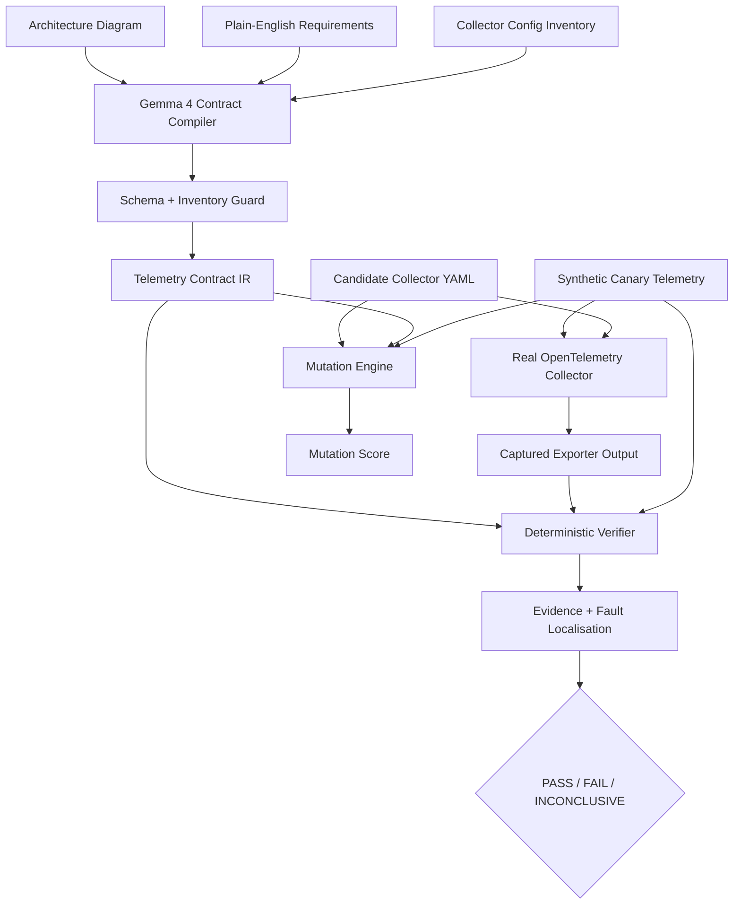

# SinkProof

> **From configuration-as-code to configuration-with-proof.**

**SinkProof** is an open-source verification harness for OpenTelemetry Collector pipelines. It turns human security and data-integrity requirements into executable telemetry contracts, runs those contracts against a **real Collector**, and mutation-tests the pipeline to prove that the tests themselves can detect regressions.

Built during **Hacktoberfest Hack Day 2026 — NIAT-KKH × MLH** with **Gemma 4**.

---

## Why SinkProof exists

Observability pipelines are no longer passive log forwarders. They redact secrets, transform attributes, route security events, preserve trace context, sample data, and decide what reaches external systems.

That creates a dangerous gap:

> **A Collector configuration can be syntactically valid and still be behaviorally wrong.**

A config may start successfully while:

- a password or token reaches an external exporter,
- a required `request.id` disappears,
- an error event is routed to the wrong destination,
- an over-broad transformation silently destroys useful context,
- or a security test passes only because no telemetry reached the sink at all.

OpenTelemetry provides configuration validation, and the ecosystem has strong tools for collection, routing, previews, and application-level trace testing. SinkProof targets a narrower problem:

> **Before deployment, can we prove that the telemetry pipeline enforces the guarantees we think it does?**

And one level deeper:

> **Would our tests notice if those guarantees broke tomorrow?**

---

## The shift we are proposing

Most telemetry workflows stop at:

```text
Write YAML
   ↓
Validate syntax
   ↓
Deploy
   ↓
Hope the behavior is correct
```

SinkProof adds a proof layer:

```text
Intent / Policy
      ↓
Executable Telemetry Contracts
      ↓
Real Collector Execution
      ↓
Deterministic Verification
      ↓
Mutation Testing
      ↓
Evidence
      ↓
Deploy / Block
```

The idea is simple:

> **Valid configuration is not the same as verified behavior.**

SinkProof moves observability infrastructure toward **policy-as-code with executable evidence**.

---

## What we built in the hackathon window

We intentionally focused on one complete vertical slice rather than pretending to build an enterprise platform in a few hours.

### 1. Telemetry Contract IR

SinkProof defines a small declarative contract language for telemetry guarantees.

Example:

```yaml
- id: no-secret-canaries
  type: forbidden_value
  sinks: [siem, analytics]
  canaries: [password, token]
  severity: critical

- id: request-id-survives
  type: preserve_field
  sink: analytics
  field:
    scope: log
    key: request.id
  severity: high
```

Current contract types include:

- `forbidden_value`
- `must_reach`
- `must_not_reach`
- `preserve_field`

These contracts are machine-checkable and versionable alongside the Collector configuration.

### 2. Real OpenTelemetry Collector execution

SinkProof does not decide correctness by only parsing YAML.

It:

1. starts a real `otel/opentelemetry-collector-contrib` container,
2. injects synthetic OTLP telemetry,
3. lets the Collector execute its real processors and routing,
4. captures exporter output,
5. evaluates the resulting telemetry.

This makes the core verdict path behavioral rather than simulated.

### 3. Deterministic verification

The model never decides PASS or FAIL.

`pipewitness/verify.py` evaluates contracts deterministically and returns:

- **PASS**
- **FAIL**
- **INCONCLUSIVE**

The verifier checks routing, forbidden values, field preservation, and non-vacuity.

### 4. Non-vacuity protection

A naïve negative assertion can produce false confidence:

> "No password was observed at the SIEM."

That statement is meaningless if **nothing reached the SIEM at all**.

SinkProof checks whether relevant synthetic canary-bearing telemetry actually exercised the destination before accepting a negative security assertion.

### 5. Telemetry mutation testing

Passing tests are not enough if the tests are weak.

SinkProof deliberately mutates known-good Collector configurations and reruns the contract suite.

Current mutation operators include:

- `drop_processor`
- `drop_ottl_statement`
- `perturb_key`
- `weaken_filter`

Each mutant is classified as:

- **KILLED** — contracts detected the regression
- **SURVIVED** — test coverage missed it
- **INVALID** — Collector validation rejected the mutant
- **INCONCLUSIVE** — runtime could not be evaluated

Mutation score:

```text
                 killed
score = -------------------------
        killed + survived
```

This asks a stronger question than "does the happy path pass?":

> **How sensitive is the contract suite to realistic telemetry-pipeline regressions?**

### 6. Failure evidence and fault localisation

When a contract fails, SinkProof records evidence such as:

- affected contract,
- sink,
- synthetic case,
- offending field/canary,
- observed value,
- pipeline path,
- processors that reference the key.

The goal is to make failures actionable rather than produce only a red/green dashboard.

### 7. Gemma 4 contract compilation

Gemma 4 receives:

- an architecture diagram,
- plain-English requirements,
- and a deterministic inventory derived from the Collector config and fixtures.

It proposes structured telemetry contracts.

The proposal then passes through `pipewitness/ai/guard.py`, which constrains generated values to known sinks, canaries, fields, scopes, and supported contract types.

The design rule is:

> **AI proposes. The verifier judges.**

### 8. Reproducible demo mode

Model responses can be recorded by an input hash and replayed for a reproducible offline demo. Replayed responses still pass through the same model-output guard before entering the verification path.

---

## Architecture



---

## Demonstrated impact

The included checkout scenario is a **seeded evaluation**, not a claim of general production accuracy.

It demonstrates that the end-to-end mechanism works.

### Vulnerable configuration

With the stronger contract suite, SinkProof identifies:

- secret/token leakage,
- email/PII-like leakage,
- loss of `request.id`,
- while still verifying routing expectations that remain correct.

Result in the recorded demo:

```text
4 PASS
3 FAIL
0 INCONCLUSIVE
```

### Corrected configuration

The same contract suite against the corrected pipeline:

```text
7 PASS
0 FAIL
0 INCONCLUSIVE
```

### Test-adequacy experiment

A deliberately weak contract suite only checks basic reachability.

```text
Weak suite:
1 / 12 evaluated mutants killed
Mutation score: 8.3%
```

The stronger suite exercises security and data-integrity invariants:

```text
Strong suite:
12 / 12 evaluated mutants killed
Mutation score: 100%
```

These figures describe the included seeded scenario only. They are evidence that the mutation mechanism differentiates a weak suite from a stronger one; they are **not** presented as an industry benchmark.

---

## What is original in SinkProof

SinkProof is not a replacement for OpenTelemetry, Cribl, Tracetest, or an observability backend.

The project contribution is the verification layer around telemetry infrastructure:

### Telemetry Contract IR
A compact representation of expected telemetry behavior.

### Non-vacuous deterministic verifier
Security/data-integrity assertions evaluated against real pipeline output.

### Structure-aware telemetry mutation engine
Collector-specific mutations that test whether the contract suite detects regressions.

### Mutation adequacy score
A measurable signal for the strength of a telemetry contract suite.

### Guarded AI-to-proof workflow
Gemma can translate human intent into candidate contracts, but deterministic runtime execution remains the source of truth.

That combination gives SinkProof a clear thesis:

> **We do not ask the model whether the pipeline is safe. We make the pipeline prove it.**

---

## Competitive position

SinkProof intentionally targets a narrow layer rather than claiming to replace mature observability products.

| Category / Tool | Primary strength | SinkProof's role |
|---|---|---|
| OpenTelemetry Collector `validate` | Checks whether configuration is valid/loadable | Tests behavioral security and data-integrity invariants |
| OpenTelemetry Collector test infrastructure | Component and integration engineering | User-facing contract verification over a candidate pipeline |
| Cribl Stream Data Preview | Inspect and validate pipeline transformations on sample data | Independent executable contracts + mutation adequacy |
| Tracetest | Trace-based application integration / end-to-end testing | Collector pipeline policy behavior |
| General AI assistants | Suggest/explain configurations | Constrained specification assistance; deterministic proof decides |
| **SinkProof** | **Pre-deployment behavioral verification** | **Contracts + real runtime + mutation testing + evidence** |

This is a positioning statement, not a claim that established tools have no overlapping capabilities.

Relevant references:

- OpenTelemetry Collector configuration: https://opentelemetry.io/docs/collector/configuration/
- OpenTelemetry Collector Contrib: https://github.com/open-telemetry/opentelemetry-collector-contrib
- Tracetest: https://docs.tracetest.io/
- Cribl Stream Data Preview: https://docs.cribl.io/stream/data-preview/

---

## Gemma 4 and open-weight AI

### Why AI exists here

Writing meaningful telemetry invariants requires translating human architecture/security intent into exact machine-checkable rules.

That is where the model helps.

Gemma 4 can interpret the combination of a visual architecture diagram and textual policy, then propose structured contracts.

### Why AI is not the security oracle

LLMs can hallucinate.

Therefore SinkProof treats model output as **untrusted proposed specification**.

```text
Diagram + Requirement
        ↓
      Gemma 4
        ↓
Candidate Contract JSON
        ↓
Schema / Inventory Guard
        ↓
Telemetry Contract IR
        ↓
Real Collector
        ↓
Deterministic Verifier
```

### Model

Primary event model:

```text
gemma-4-26b-a4b-it
```

through the Gemini API.

The code also includes an Ollama-compatible local backend for experimentation with open-weight models.

---

## Five-hour engineering philosophy

A production-grade verification platform cannot be built in a single hackathon session.

So we chose depth over feature count.

### What we prioritized

- one real OpenTelemetry signal path,
- one real Collector runtime,
- one constrained Contract IR,
- deterministic evidence,
- mutation testing,
- multimodal AI contract proposal,
- a CLI and visual demo.

### What we intentionally did not pretend to finish

- production-scale traces/metrics support,
- arbitrary enterprise Collector topologies,
- generalized autonomous remediation,
- organization-wide policy management,
- long-running drift monitoring,
- multi-engine support,
- large-scale benchmark claims.

The hackathon deliverable is the **proof of the verification model**, not a claim that SinkProof is already an enterprise product.

---

## Future: from hackathon harness to telemetry proof layer

The current prototype establishes the core loop:

```text
Specify → Execute → Verify → Mutate → Evidence
```

The roadmap expands it into:

```text
Specify
   ↓
Generate adversarial telemetry
   ↓
Execute across pipeline engines
   ↓
Verify contracts
   ↓
Mutation / fuzz coverage
   ↓
Diagnose
   ↓
Propose patch
   ↓
Re-run in sandbox
   ↓
Cryptographically reproducible evidence
   ↓
CI/CD policy gate
```

### Phase 1 — Generalize the foundation

- derive all sinks dynamically from Collector inventory,
- pin Collector versions/digests for reproducibility,
- add trace and metric contract types,
- add processor reorder, exporter reroute, sampling, scope, and pipeline mutations,
- add additional independent example topologies,
- produce JSON/SARIF-style artifacts.

### Phase 2 — Verified AI remediation

Move from the current bounded demonstration to a fully constrained loop:

```text
Failure Evidence
      ↓
Gemma Patch Proposal
      ↓
Allow-listed PatchOp IR
      ↓
Collector Validate
      ↓
Sandbox Execution
      ↓
Contract Verification
      ↓
Mutation Verification
      ↓
VERIFIED FIX / REJECTED PATCH
```

The model proposes a fix; SinkProof only accepts it after runtime proof.

### Phase 3 — CI/CD policy gate

Target developer workflow:

```bash
sinkproof verify \
  --config otel-collector.yaml \
  --contracts telemetry.contracts.yaml
```

Potential outputs:

- pull-request annotations,
- SARIF findings,
- mutation score thresholds,
- signed evidence artifacts,
- deployment block/pass exit codes.

### Phase 4 — Cross-pipeline adapters

Extend the Contract IR beyond OpenTelemetry with adapters for telemetry processors such as:

- Vector,
- Fluent Bit,
- other programmable telemetry pipelines.

The long-term goal is for contracts to describe **what must be true**, independently from the specific engine enforcing it.

### Phase 5 — Research-grade verification

Explore:

- property-based telemetry generation,
- coverage-guided configuration mutation,
- differential testing between pipeline versions,
- contract inference from historical telemetry,
- adversarial PII/secret transformations,
- formal semantics for selected invariant types,
- reproducible evidence bundles for audits and change reviews.

---

## Quick start

### Prerequisites

- Python 3.11+
- Docker
- Git

### Install

```bash
git clone https://github.com/Saisharathchandranandnetha/SinkProof.git
cd SinkProof

python3 -m venv .venv
source .venv/bin/activate
pip install -e .
```

### Optional live Gemma configuration

```bash
cp .env.example .env
```

Set:

```text
GEMINI_API_KEY=
PW_GEMMA_MODEL=gemma-4-26b-a4b-it
```

Never commit the `.env` file.

---

## Run the core demo

### Verify the vulnerable pipeline

```bash
sinkproof verify \
  -c examples/checkout/collector.vulnerable.yaml \
  -k examples/checkout/contracts.yaml \
  -t examples/checkout/telemetry.yaml
```

Expected overall verdict: **FAIL**.

### Verify the corrected pipeline

```bash
sinkproof verify \
  -c examples/checkout/collector.fixed.yaml \
  -k examples/checkout/contracts.yaml \
  -t examples/checkout/telemetry.yaml
```

Expected overall verdict: **PASS**.

### Mutation-test the contract suite

```bash
sinkproof mutate \
  -c examples/checkout/collector.fixed.yaml \
  -k examples/checkout/contracts.yaml \
  -t examples/checkout/telemetry.yaml
```

### Compile contracts with Gemma 4

```bash
sinkproof compile \
  -i examples/checkout/architecture.png \
  -r examples/checkout/requirements.txt \
  -c examples/checkout/collector.fixed.yaml \
  -t examples/checkout/telemetry.yaml \
  -o compiled.yaml
```

### Interactive UI

```bash
streamlit run app.py
```

---

## Repository map

| Component | Path |
|---|---|
| Contract IR | `pipewitness/contracts.py` |
| Real Collector runner | `pipewitness/runner.py` |
| Deterministic verifier | `pipewitness/verify.py` |
| Mutation engine | `pipewitness/mutate.py` |
| Evidence model | `pipewitness/evidence.py` |
| Fault localisation | `pipewitness/localize.py` |
| Gemma integration | `pipewitness/ai/gemma.py` |
| Model-output guard | `pipewitness/ai/guard.py` |
| Bounded remediation prototype | `pipewitness/ai/remediate.py` |
| Demo app | `app.py` |
| Seeded checkout scenario | `examples/checkout/` |

---

## Current limitations

- Full runtime verification currently focuses on OTLP log telemetry.
- The seeded checkout scenario is the primary demonstrated topology.
- Some AI compiler sink mapping remains example-specific and is planned to be generalized.
- The remediation module is currently a bounded seeded prototype, not a general autonomous repair engine.
- Docker is the primary Collector execution backend.
- The project verifies technical properties; it does **not** claim to certify regulatory compliance.

These constraints are intentionally documented because the core principle of SinkProof is evidence over claims.

---

## Challenge fit

### Best Open-Source AI Project

SinkProof is an original open-source verification/model harness where open-weight AI helps compile human intent into guarded contracts, while original deterministic infrastructure executes, verifies, mutates, and scores the pipeline.

### Best Use of Gemma 4

Gemma 4 is used through the Gemini API to combine **architecture-image understanding + textual requirements** into structured contract proposals. Its multimodal output becomes immediately useful because those proposals feed the executable verification path.

---

## License

Apache License 2.0. See [LICENSE](LICENSE).

---

## The idea in one sentence

> **SinkProof does not replace your telemetry pipeline — it makes the pipeline prove that it deserves your trust.**
